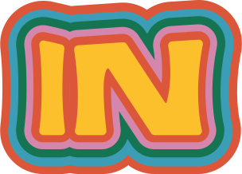
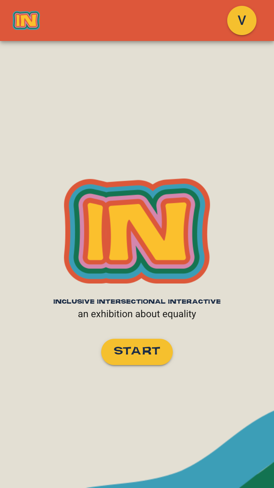
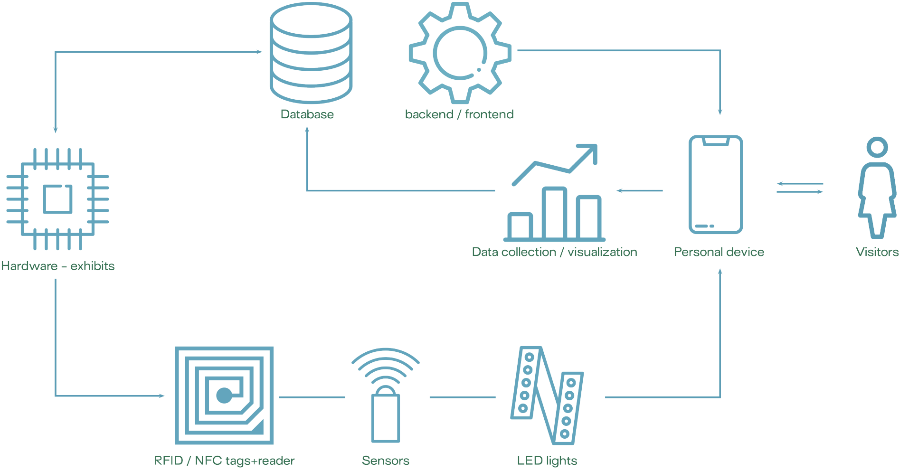

<div align="center">



# IN · Inclusive Intersectional Interactive

**The companion web app of _an exhibition about equality_**

<a href="https://toyo97.github.io/in-exhibition-app">
  
</a>

<br/>


</div>

---

## About

**IN** is the web app of *IN — Inclusive Intersectional Interactive, an exhibition about equality*: an interactive exhibition on the UN **Sustainable Development Goals** designed and built for the [ASP — Alta Scuola Politecnica](https://www.asp-poli.it/) programme.

During the visit it acts as a guide and companion: it walks visitors through the exhibition, prompts **quizzes** related to each exhibit and lets them interact with the **sensors** hidden in the exhibits — turning the whole path into a **gamified** experience.

**▶ [Try the live demo](https://toyo97.github.io/in-exhibition-app)**

<p align="center">
  
</p>

## Behind the exhibits

<p align="center">
  
</p>

- Visitors interact from their own phone: the app scans the **QR code** at each exhibit and unlocks its content.
- The exhibits themselves talk through **RFID/NFC tags + readers, sensors and LED lights**, driven by a backend and a database.
- Every interaction is collected for **data visualization** — and feeds the visitor's score.

| | |
|---|---|
| 🧩 **Frontend** | Vue.js · Vuex · Vue Router · Vuetify |
| 📷 **Exhibit interaction** | QR-code scanning (`vue-qrcode-reader`) |
| 🔊 **Media** | in-app audio stories & playback (`vue-audio-better`) |
| 🚀 **Deployment** | GitHub Actions → GitHub Pages |

## Run it locally

```bash
git clone https://github.com/toyo97/in-exhibition-app
cd in-exhibition-app
npm install
npm run serve   # → http://localhost:8080
```

## Acknowledgements

**Co-authors** — app designed & developed by [@toyo97](https://github.com/toyo97) with the ASP project team: academic tutors *Franca Garzotto · Pietro Crovari · Fabio Catania* (Politecnico di Milano) and *Irene Barcarolo · Sergio Degiacomi · Valentina Ferreri · Alessia Kayalibay · Anika Rieth · Valeriia Vapelnyk · Vittorio Zampinetti · Francesca Zoccarato*.

**External institutions & companies** — Impactscool · On-Air · I3d LAB.

---

<div align="center">

      

<sub>_exhibition palette · IN — an exhibition about equality_</sub>

</div>
